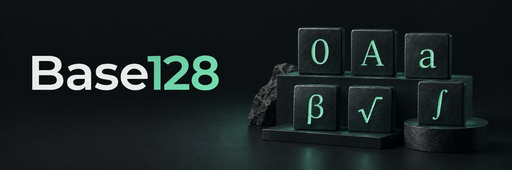
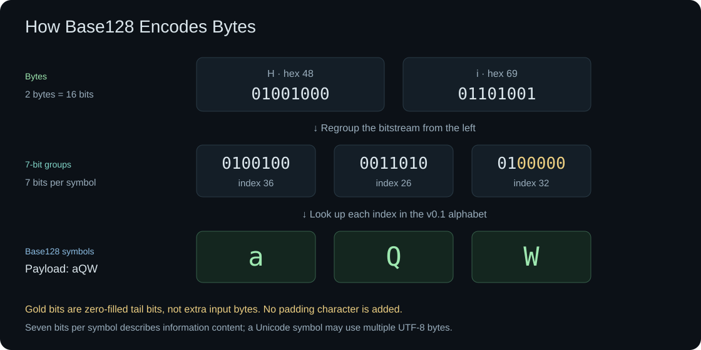

# Base128



A small, dependency-free encoding library built around a fixed **128-character Unicode alphabet**, with support for user-defined alphabets. Includes JavaScript/TypeScript, Python, a streaming CLI, and a browser playground.

**Version:** 0.4.0 · **License:** Apache-2.0 · **Status:** Working implementation / prepublication; package names are provisional.

> Base128 is **not Base64-compatible** and is not interchangeable with other libraries also called "Base128". Its exact algorithm and alphabet are defined in [`specs/encoding-v4.md`](specs/encoding-v4.md).

## Why Base128?

A 128-symbol alphabet provides exactly **7 bits per displayed symbol**. The binary algorithm uses simple 7-bit packing; the integer algorithm uses positional base-128 arithmetic. ASCII/UTF-8 are converted into bytes before binary encoding; they aren't independent Base128 algorithms.

- ASCII digits `0–9` (indices 0–9)
- Uppercase Latin letters `A–Z` (indices 10–35)
- Lowercase Latin letters `a–z` (indices 36–61)
- ASCII punctuation in ascending code-point order (indices 62–93)
- 9 uppercase Greek symbols `ΓΔΘΛΞΠΦΨΩ` (indices 94–102)
- 19 lowercase Greek symbols `αβγδεζηθικλμξπστφψω` (indices 103–121)
- 6 mathematical symbols `∂∇∏∑√∫` (indices 122–127)

The default alphabet is in [`specs/alphabet-v4.json`](specs/alphabet-v4.json). An optional [two-byte preset and decoder alias mode](#two-byte-alternative-and-decoder-aliases) are also available. Other valid ordered sets of exactly 128 distinct Unicode scalar values may be supplied as configuration. No headers, prefixes, checksums, or padding characters are inserted.


**Important:** Base128 usually uses fewer visible characters than Base64, but it may use **more UTF-8 bytes** and is not URL-safe, shell-safe, or visually unambiguous. It provides neither encryption nor checksums. Avoid using encoded text as an unescaped URL component or assuming it resists transcription errors.

## How it works

Binary encoding reads the input bits in groups of seven, zero-fills the final group when needed, and maps each group to an alphabet symbol. For example, UTF-8 `Hi` becomes `aQW`:



Integer encoding uses positional base-128 arithmetic instead: `126 → √`, `127 → ∫`, `128 → 10`, and `129 → 11`.

## Quick start

### JavaScript / TypeScript

Run this repository locally with Node.js 20+:

```bash
node --input-type=module <<'JS'
import {encode, decode, encodeInteger, decodeInteger, createAlphabet} from './packages/js/dist/index.js';

const bytes = new TextEncoder().encode('Hello, 世界!');
const encoded = encode(bytes);
console.log(encoded);
console.log(new TextDecoder('utf-8', {fatal:true}).decode(decode(encoded)));

console.log(encodeInteger(1000n)); // 7β
console.log(decodeInteger('7β')); // 1000n

// Example: reverse the default alphabet (still 128 unique characters)
const {DEFAULT_ALPHABET_TEXT} = await import('./packages/js/dist/index.js');
const custom = createAlphabet(Array.from(DEFAULT_ALPHABET_TEXT).reverse().join(''));
console.log(encode(bytes, {alphabet:custom}));
JS
```

The JavaScript package is built from TypeScript sources and ships its compiled ESM and `.d.ts` declarations. It has **zero runtime npm dependencies**. A local TypeScript compiler is only required to rebuild from source.

### Python

```bash
PYTHONPATH=packages/python python - <<'PY'
from base128 import encode, decode, encode_integer, decode_integer, create_alphabet

encoded = encode('Hello, 世界!'.encode('utf-8'))
print(encoded)
print(decode(encoded).decode('utf-8'))
print(encode_integer(1000))  # 7β
assert decode_integer('7β') == 1000
PY
```

Requires Python 3.10+. **Zero third-party runtime dependencies.** The proposed distribution name `unicode-base128` is not verified available on PyPI.

### CLI

```bash
# Byte-preserving stream encoding and decoding
printf 'Hello!' | node packages/cli/bin/base128.mjs encode
printf 'Hello!' | node packages/cli/bin/base128.mjs encode | node packages/cli/bin/base128.mjs decode

# Files (binary input and output, transactional on disk)
node packages/cli/bin/base128.mjs encode image.png -o image.b128
node packages/cli/bin/base128.mjs decode image.b128 -o restored.png

# Integer conversion (never appends a newline)
node packages/cli/bin/base128.mjs integer encode 1000  # 7β
node packages/cli/bin/base128.mjs integer decode '7β'  # 1000

# Custom alphabet, exactly 128 Unicode code points in the file, without a newline
node packages/cli/bin/base128.mjs encode image.png --alphabet-file alphabet.txt -o image.b128
```

Encoded binary output has **no terminal newline**, and binary decoding rejects whitespace. Use `printf` rather than `echo` if piping encoded strings into `decode`.

The CLI streams files rather than reading them fully into memory. With `-o`, its output is written to a temporary file then atomically renamed on successful completion, so invalid input cannot overwrite an existing destination. When output is stdout, consumers must check the process exit code because a stream decoder can emit initial bytes before detecting an invalid final group.

### Website

Live site: **https://shea256.github.io/base128/**

GitHub Actions builds, tests, and deploys the site to GitHub Pages on every push to `master`. The [Deploy website workflow](.github/workflows/pages.yml) can also be run manually from the Actions tab. Repository Settings → Pages must use **GitHub Actions** as the publishing source. Only static website assets are published.

```bash
npm run site
# Open http://localhost:8080/
```

The `website/` directory is a self-contained static site (its `vendor/` directory contains copies of the compiled ESM library). You can serve or deploy it using any static server. The local preview server uses only Node.js built-ins. The website implements live text, hexadecimal byte, and integer conversions; default, two-byte, and custom alphabets; byte-size comparison; a 128-symbol explorer; and browser-local file conversion. Browser file conversion loads the file into memory; use the CLI for large files.

The default alphabet uses **format v4**. Existing v1, v2, or v3 payloads require their explicit legacy alphabet; see the [migration guide](specs/encoding-v4.md#6-migration-from-earlier-versions). The [spoken alphabet table](specs/spoken-alphabet-v4.md) lists every character and its telephone name.

## Development and testing

```bash
# Node.js >=20, Python >=3.10
# TypeScript >=5.8 compiler is needed only for regenerating JS build output.
npm install        # installs TypeScript dev dependency; zero runtime dependencies
npm test           # rebuilds; JS, Python, interoperability, CLI tests
npm run build      # compiles JS + refreshes website/vendor
npm run test:js
npm run test:python
npm run test:integration
npm run test:cli
```

The generated JS `packages/js/dist/` and `website/vendor/` are included in this repository so the CLI and site can be used directly without first running a build.

The README's alphabet chart and encoding diagram are generated from the v4 alphabet with `node scripts/build-readme-images.mjs` after building the JavaScript library. The cover illustration's generation prompt is saved in [`docs/images/cover-prompt.txt`](docs/images/cover-prompt.txt).

The compatibility fixtures in [`specs/test-vectors.json`](specs/test-vectors.json) were independently generated from bit-string grouping and division/modulus logic, not from either language library. The cross-language integration tests additionally compare hundreds of random byte arrays and integers between Python and Node with default and custom alphabets.

## Repository

```text
base128/
├── packages/
│   ├── js/                 # TypeScript source, compiled ESM + .d.ts
│   ├── python/             # Python stdlib-only package
│   └── cli/                # Node.js streaming CLI
├── website/                # Standalone static playground and alphabet atlas
├── specs/                  # Normative v4 spec, alphabet, fixtures
├── scripts/                # Builds and cross-language testing
└── .github/workflows/      # Continuous integration
```

## Design decisions

1. Two encoding primitives: **binary 7-bit packing**, **integer radix conversion**.
2. Text is handled as binary after explicit UTF-8 conversion; no separate ASCII/Unicode algorithm.
3. The default alphabet is immutable/versioned. A custom alphabet requires matching configuration on decode.
4. Strict canonical representation: binary padding bits and encoded length are validated; integer leading-zero digits are rejected.
5. Binary streams carry incomplete bit groups across chunks; decoding validates on finalization.
6. No prefixes, length headers, output padding characters, framing, checksums, or compression.
7. No external **runtime** dependencies; TypeScript compilation needs a **development** dependency.
8. The optional two-byte v1 preset preserves digit values; decoder aliases are opt-in.

## Package naming

The public project is named **Base128**. The proposed npm name `base128-unicode-codec` and PyPI name `unicode-base128` are **not verified to be registrable**. Confirm availability, trademark considerations, and publisher ownership before publishing or changing these fields. Our format is not compatible with `rpuntaie/base128` and the latter's alternative alphabets/metadata format.

## License

Apache License, Version 2.0. See [`LICENSE`](LICENSE). Contributions are welcome; see [`CONTRIBUTING.md`](CONTRIBUTING.md).

## Using a repository checkout

The package names in manifests and examples are not a guarantee of npm or PyPI
publication. The CLI package is private. These checkout-based paths work without
assuming any registry release:

```sh
npm ci
npm run build
node packages/cli/bin/base128.mjs --help
```

- **JavaScript/TypeScript:** import from `./packages/js/dist/index.js` when running
  at the repository root. The build includes TypeScript declarations.
- **Python:** create and activate a virtual environment, then run
  `python -m pip install -e ./packages/python`; import from `base128`. Alternatively,
  set `PYTHONPATH` to `packages/python` to use the source without installation.
- **CLI:** run `node packages/cli/bin/base128.mjs`. See the [CLI reference](docs/cli.md)
  for streams, exit codes, alphabet options, and transactional file output.

Run `npm test` for all checks. It discovers Python 3.10+ automatically using
`python3`, `python`, or Windows `py -3`; override with the `PYTHON` executable path.
See [AGENTS.md](AGENTS.md) for agent and contributor guidance.

## Two-byte alternative and decoder aliases

The optional **two-byte v1** preset preserves the first 122 digits of the default
v4 alphabet and replaces the final six in Unicode code-point order:

| Value | Default v4 | Two-byte v1 | Alternative spoken name |
| ---: | :---: | :---: | --- |
| 122 | ∂ | § | Section |
| 123 | ∇ | © | Copyright |
| 124 | ∏ | ® | Registered |
| 125 | ∑ | ° | Degree |
| 126 | √ | ¶ | Paragraph |
| 127 | ∫ | ÷ | Division |

Every character in this preset uses at most two UTF-8 bytes. Its ordered mapping
is fixed in [the specification](specs/alphabet-two-byte-v1.json); the
[alphabet file](specs/alphabet-two-byte-v1.txt) has no terminating newline.
The default encoder and its existing outputs are unchanged.

```js
import {encode, decode, TWO_BYTE_ALPHABET} from './packages/js/dist/index.js';
const text = encode(bytes, {alphabet: TWO_BYTE_ALPHABET});
const restored = decode(text, {acceptAliases: true});
```

```python
from base128 import encode, decode, TWO_BYTE_ALPHABET
text = encode(b'Hello', alphabet=TWO_BYTE_ALPHABET)
restored = decode(text, accept_aliases=True)
```

```sh
node packages/cli/bin/base128.mjs encode input.bin --alphabet two-byte -o output.b128
node packages/cli/bin/base128.mjs decode output.b128 --accept-aliases -o restored.bin
```

By default, decoding is strict to the selected alphabet. Opt-in `acceptAliases`
(JavaScript), `accept_aliases` (Python), or `--accept-aliases` (CLI) accepts either
symbol in each table row, including mixed input. This works for binary, streaming,
and integer decoders. It is restricted to the exact default v4 and two-byte v1
layouts, including those supplied as strings; other custom alphabets are rejected
when alias mode is requested. No alphabet detection or Unicode normalization is
performed. Length, trailing padding bits, and integer leading-zero checks still
apply. Alias decoding allows multiple text spellings of the same value;
re-encoding emits only the selected alphabet's canonical spelling.

For text comparison, hashing, or signing, choose one canonical alphabet and
re-encode alias-decoded values before using their textual representation.

### Website alphabet controls

The website's alphabet selector controls the converter, file tool, and explorer.
Default v4 and two-byte v1 decoding are strict unless **Accept both alphabets when
decoding** is checked. Selecting a custom alphabet disables alias acceptance.
