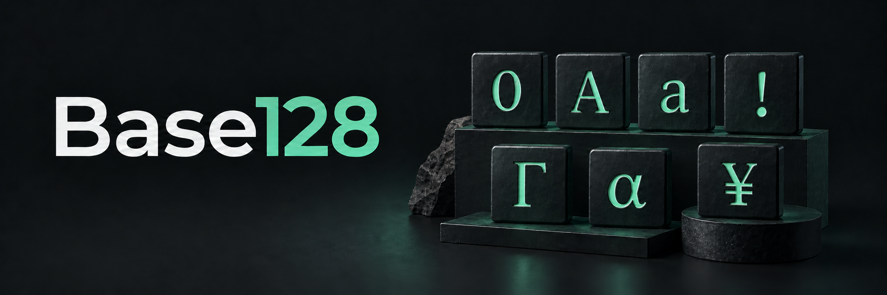
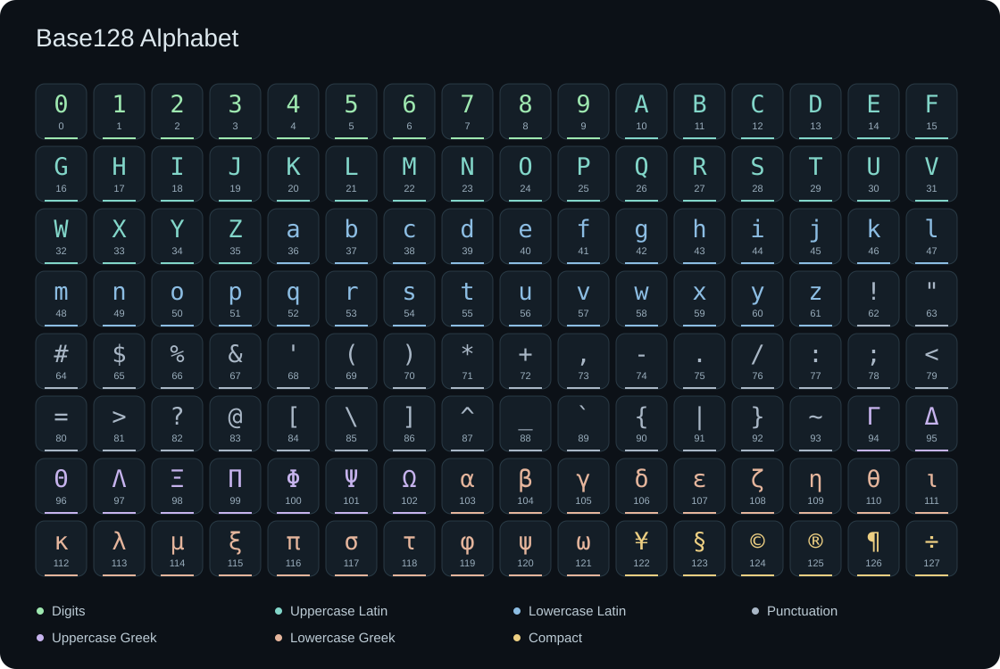

# Base128



A small, dependency-free library for encoding bytes and nonnegative integers with a configurable **128-character Unicode alphabet**. Includes JavaScript/TypeScript, Python, a streaming CLI, and a browser playground.

**Version:** 0.1.0 · **License:** Apache-2.0 · **Status:** Working implementation / prepublication.

**[Try the live playground](https://shea256.github.io/base128/)** · [Encoding specification](specs/encoding.md) · [CLI reference](docs/cli.md)

## Contents

- [Why Base128?](#why-base128)
- [Getting started](#getting-started)
- [Usage](#usage)
- [Alphabets and decoding](#alphabets-and-decoding)
- [Optional prefixes and checksums](#optional-prefixes-and-checksums)
- [How it works](#how-it-works)
- [Compatibility and limitations](#compatibility-and-limitations)
- [Development and testing](#development-and-testing)
- [Repository and contributing](#repository-and-contributing)
- [License](#license)

## Why Base128?

Each Base128 symbol carries **7 bits**, compared with Base64's 6 bits per symbol. This usually means fewer displayed characters for the same bytes. The format has a fixed, documented mapping, supports custom alphabets, and produces matching output in JavaScript and Python without runtime dependencies.

Fewer characters does **not** necessarily mean smaller storage: Unicode symbols can occupy multiple UTF-8 bytes. The playground compares both character counts and byte sizes. The default Compact alphabet limits every symbol to at most two UTF-8 bytes; Math is an optional alternative.

Base128 is useful when you want this specific Unicode representation. It is not Base64-compatible, URL-safe, shell-safe, or visually unambiguous; see [limitations](#compatibility-and-limitations).

## Getting started

Use a repository checkout. The manifest names `base128-unicode-codec` (npm) and `unicode-base128` (PyPI) are provisional and do not establish registry availability. The CLI package is private; the examples below do not require a published package.

Run commands from the repository root. Shell examples use a POSIX-compatible shell.

| Interface | Requirement | Checkout entry point |
| --- | --- | --- |
| JavaScript / TypeScript | Node.js 20+ | `packages/js/dist/index.js` (ESM and `.d.ts` declarations) |
| Python | Python 3.10+ | `packages/python/base128` |
| CLI | Node.js 20+ | `node packages/cli/bin/base128.mjs` |
| Website | A modern browser; Node.js for local preview | [Live playground](https://shea256.github.io/base128/) or `npm run site` |

Compiled JavaScript and browser vendor files are tracked, so the CLI and site can run directly from a checkout. To install development dependencies and rebuild:

```sh
npm ci
npm run build
```

For Python, either use `PYTHONPATH=packages/python` as below, or install the local package into a virtual environment:

```sh
python3 -m venv .venv
. .venv/bin/activate
python -m pip install -e ./packages/python
```

On Windows, use the equivalent virtual-environment activation command and environment-variable syntax. The libraries have no third-party runtime dependencies; rebuilding JavaScript requires the TypeScript development dependency.

## Usage

### JavaScript / TypeScript

```sh
node --input-type=module <<'JS'
import {encode, decode, encodeInteger, decodeInteger} from './packages/js/dist/index.js';

const bytes = new TextEncoder().encode('Hello, 世界!');
const encoded = encode(bytes);
console.log(encoded);
console.log(new TextDecoder('utf-8', {fatal: true}).decode(decode(encoded)));

console.log(encodeInteger(1000n)); // 7β
console.log(decodeInteger('7β')); // 1000n
JS
```

JavaScript integer conversion uses `bigint`, avoiding precision loss from large `number` values. See the [JavaScript package README](packages/js/README.md) for more examples.

### Python

```sh
PYTHONPATH=packages/python python3 - <<'PY'
from base128 import encode, decode, encode_integer, decode_integer

encoded = encode('Hello, 世界!'.encode('utf-8'))
print(encoded)
print(decode(encoded).decode('utf-8'))
print(encode_integer(1000))  # 7β
assert decode_integer('7β') == 1000
PY
```

Python integer conversion uses arbitrary-precision `int`. See the [Python package README](packages/python/README.md).

### CLI

```sh
# Byte-preserving stream round trip
printf 'Hello!' | node packages/cli/bin/base128.mjs encode | node packages/cli/bin/base128.mjs decode

# Files
node packages/cli/bin/base128.mjs encode image.png -o image.b128
node packages/cli/bin/base128.mjs decode image.b128 -o restored.png

# Integer conversion
node packages/cli/bin/base128.mjs integer encode 1000  # 7β
node packages/cli/bin/base128.mjs integer decode '7β'  # 1000
```

Output has **no added terminal newline**, and decoding rejects whitespace. Use `printf` rather than `echo` when piping encoded strings into `decode`.

Bare CLI operations stream files; wrapped operations buffer input. With `-o`, it writes a temporary file and renames it only after successful completion; invalid input cannot overwrite an existing destination. Stdout can contain partial decoded bytes before a validation failure, so consumers must check the exit status. See the [CLI reference](docs/cli.md) for all options and error behavior.

### Website

Use the **[live playground](https://shea256.github.io/base128/)** or start a local preview:

```sh
npm run site
# Open http://localhost:8080/
```

The alphabet selector applies to the text/hex/integer converter, file tool, and symbol explorer. Choose Compact, Math, or Custom. Decoding is strict unless **Allow alternate payload symbols** is checked in Decode mode; the file tool has its own decoding option. Custom alphabets use strict decoding. Independent **Add / require prefix** and **Add / require checksum** controls apply to encoding and decoding. The selected mode and alphabet must match a supplied prefix.

The site also compares UTF-8 size and character counts. Files are processed locally in the browser and loaded into memory; use the CLI without wrapper options to stream large files.

## Alphabets and decoding

### Compact alphabet (default)

The Compact alphabet is an immutable, ordered set of 128 distinct Unicode scalar values:

| Indices | Characters |
| --- | --- |
| 0–9 | ASCII digits `0–9` |
| 10–35 | Uppercase Latin letters `A–Z` |
| 36–61 | Lowercase Latin letters `a–z` |
| 62–93 | ASCII punctuation, in ascending code-point order |
| 94–102 | Uppercase Greek `ΓΔΘΛΞΠΦΨΩ` |
| 103–121 | Lowercase Greek `αβγδεζηθικλμξπστφψω` |
| 122–127 | Compact symbols `¥§©®¶÷` |



The [alphabet specification](specs/alphabet.json) fixes every index and code point. The [spoken alphabet table](specs/spoken-alphabet.md) provides proposed telephone names and numeric fallbacks.

### Alternative alphabets

Compact is the default. Math is an optional built-in alphabet with the same first 122 symbols and a different six-symbol suffix. Both use the same encoding algorithms.

Select an alphabet with `{alphabet: MATH_ALPHABET}` in JavaScript, `alphabet=MATH_ALPHABET` in Python, or `--alphabet math` in the CLI. Both libraries export `COMPACT_ALPHABET` and `MATH_ALPHABET`; `DEFAULT_ALPHABET` aliases Compact. Use the same alphabet when encoding and decoding.

See the [alphabet mappings](specs/encoding.md#11-optional-math-preset-and-alias-decoding) for the symbol comparison and [spoken tables](specs/spoken-alphabet.md) for reading names.

### Custom alphabets

Supply exactly **128 unique Unicode scalar values** in digit order. Encoders and decoders must agree on the mapping; the payload carries no alphabet identifier.

```js
import {DEFAULT_ALPHABET_TEXT, createAlphabet, encode, decode} from './packages/js/dist/index.js';

const alphabet = createAlphabet(Array.from(DEFAULT_ALPHABET_TEXT).reverse().join(''));
const bytes = Uint8Array.of(1, 2, 3);
const text = encode(bytes, {alphabet});
const restored = decode(text, {alphabet});
```

Python accepts `alphabet=...` as text or a compiled `create_alphabet(...)` result. The CLI accepts `--alphabet-file FILE`, containing the exact UTF-8 alphabet with no terminating newline. The website accepts custom text under **Custom alphabet**.

### Decoder aliases

**Decoding is strict to the selected alphabet by default.** Opt-in alias decoding accepts corresponding Compact and Math symbols, including mixed spellings in one payload:

| Interface | Enable aliases |
| --- | --- |
| JavaScript | `{acceptAliases: true}` |
| Python | `accept_aliases=True` |
| CLI | `--accept-aliases` |
| Website | **Allow alternate payload symbols** (Decode mode) |

Aliases work with binary, streaming, and integer decoders using either exact built-in layout. Unrelated custom alphabets are rejected in alias mode. Aliases do not detect alphabets, normalize text, or relax length, padding, and integer leading-zero checks. Envelope headers and checksums always use strict spelling.

Alias mode allows multiple strings to represent the same value. For text comparison, hashing, or signing, choose one canonical alphabet and re-encode decoded values into it, or use strict decoding. See the [alias specification](specs/encoding.md#11-optional-math-preset-and-alias-decoding) for the exact mapping and rules.

## Optional prefixes and checksums

Bare encoding remains the default. Use `wrap` on encoded text to independently
add a prefix, a checksum, or both:

| Options | Output form |
| --- | --- |
| Prefix only | `b128·00·payload` |
| Checksum only | `payload·checksum` |
| Both | `b128·00·payload·checksum` |

The header uses a fixed Base128 alphabet: its first character identifies format
version `0`, and its second packs four alphabet bits followed by three mode bits.
Compact is alphabet 0, Math is 1; binary is mode 0, integer is 1. The four headers
are `00` (Compact binary), `01` (Compact integer), `08` (Math binary), and `09`
(Math integer). Alphabet field 15 introduces one extra character for IDs 15–142;
only IDs 0 and 1 are currently assigned. Version 127 is reserved and rejected.
Middle dot (`·`, U+00B7) appears in
neither built-in alphabet. The checksum is four CRC-32 bytes encoded into exactly
five Base128 symbols using the payload alphabet. It covers the exact UTF-8 text before the checksum separator, including the
`b128` identifier, header, and intervening separators when a prefix is present.
Without a prefix, it covers only the payload.

```js
import {encode, decode, wrap, unwrap} from './packages/js/dist/index.js';

const wrapped = wrap(encode(new TextEncoder().encode('Hello')), {
  prefix: true, checksum: true,
});
const result = unwrap(wrapped, {prefix: true, checksum: true});
const bytes = decode(result.payload, {alphabet: result.alphabet});
```

```python
from base128 import encode, decode, wrap, unwrap

wrapped = wrap(encode(b'Hello'), prefix=True, checksum=True)
result = unwrap(wrapped, prefix=True, checksum=True)
raw_bytes = decode(result.payload, alphabet=result.alphabet)
```

```sh
node packages/cli/bin/base128.mjs encode input.bin --prefix --checksum -o output.b128
node packages/cli/bin/base128.mjs decode output.b128 --prefix --checksum -o restored.bin
node packages/cli/bin/base128.mjs integer encode 1000 --prefix --checksum
```

Use the same wrapper flags when decoding: missing fields are errors, not a reason
to skip verification. Library `unwrap` infers mode and alphabet from a prefix
unless you supply constraints. For integers, call `wrap(encoded, {mode: 'integer', ...})`
in JavaScript or `wrap(encoded, mode='integer', ...)` in Python, then use
`decodeInteger` / `decode_integer` on the unwrapped payload.

Prefixes support built-in alphabets only. Checksum-only wrappers also support
custom alphabets that exclude middle dot. Alias decoding is opt-in for the payload;
checksums are always strict and must be recalculated if the encoded spelling changes.
These checks detect accidental corruption, not deliberate tampering.

Wrapper helpers operate on complete values, and wrapped CLI operations buffer
input. See the [envelope specification](specs/envelope.md) for exact grammar,
checksum parameters, and validation rules.

## How it works

**Binary encoding** reads bytes in most-significant-bit-first groups of seven, zero-fills the final group if necessary, and maps each group to a symbol. For example, UTF-8 `Hi` becomes `aQW`:


For `n` bytes, binary encoding emits `ceil(8n / 7)` symbols. Decoding validates the encoded length and trailing zero bits. Streaming encoders and decoders carry incomplete bit groups between chunks; decoders validate final length and padding when finalized.

**Integer encoding** uses minimal, big-endian positional base-128 arithmetic: `126 → ¶`, `127 → ÷`, `128 → 10`, and `129 → 11` with the default alphabet. Negative values and unnecessary leading zero digits are rejected.

**Binary and integer representations are not interchangeable.** Binary mode preserves byte length and leading zero bytes; integer mode represents a numeric value. Text uses explicit UTF-8 conversion followed by binary encoding—there is no separate text encoding algorithm.

## Compatibility and limitations

- Base128 is **not Base64-compatible** or interchangeable with other projects called “Base128.” The [v0.1 specification](specs/encoding.md) defines this format.
- Bare encodings have no prefixes or checksums; optional envelopes add these. Neither form includes authentication, encryption, compression, or multi-record framing. Zero-filled final bits are part of binary packing; there are no padding characters.
- No implicit whitespace trimming, case folding, or Unicode normalization occurs. Preserve exact characters and use strict UTF-8 decoding when textual round-trip accuracy matters.
- Output is not URL-safe or shell-safe. Escape it for its destination and quote command-line arguments; files and stdin avoid shell interpretation of arbitrary payloads.
- Some symbols resemble one another. Successful decoding alone does not establish accurate transcription.
- A smaller symbol count does not guarantee fewer UTF-8 bytes than Base64.

## Development and testing

From the repository root, with Node.js 20+ and Python 3.10+:

```sh
npm ci
npm test                   # rebuild; JS, Python, interoperability, CLI, website tests
npm run build              # compile JS and refresh website/vendor
npm run test:js
npm run test:python
npm run test:integration
npm run test:cli
npm run test:website
```

The test runner discovers Python using `python3`, `python`, or Windows `py -3`. Set `PYTHON` to an executable path to override discovery. Run `npm run build` before focused tests when TypeScript or browser vendor inputs change.

The shared [default vectors](specs/test-vectors.json) and [math vectors](specs/test-vectors-math.json) are independently generated from bit grouping and positional arithmetic. Cross-language checks compare JavaScript and Python across default, alternative, and custom alphabets. Website interaction tests cover preset selection, aliases, the explorer, and file decoding.

Generated `packages/js/dist/` and `website/vendor/` files are tracked; commit rebuilt outputs with their source changes. README figures are generated with `node scripts/build-readme-images.mjs` after building the library. The cover illustration's prompt is in [`docs/images/cover-prompt.txt`](docs/images/cover-prompt.txt).

GitHub Actions [builds, tests, and deploys](.github/workflows/pages.yml) the static website on pushes to `master`; the workflow can also be dispatched manually. GitHub Pages must use **GitHub Actions** as its publishing source. PR branches do not update the live site.

## Repository and contributing

```text
base128/
├── packages/
│   ├── js/                 # TypeScript source, compiled ESM + declarations
│   ├── python/             # Python stdlib-only package
│   └── cli/                # Node.js streaming CLI
├── website/                # Static playground, explorer, and interaction tests
├── specs/                  # Versioned specifications, alphabets, and vectors
├── scripts/                # Builds, interpreter discovery, and interoperability checks
├── docs/                   # CLI reference and README images
├── AGENTS.md               # Agent setup, generated files, and compatibility rules
└── .github/workflows/      # CI and GitHub Pages deployment
```

Read [CONTRIBUTING.md](CONTRIBUTING.md) for contribution requirements and [AGENTS.md](AGENTS.md) for agent and maintainer guidance. Published alphabet mappings are immutable; format changes need a separately documented version. Keep both language implementations and their tests aligned.

## License

Apache License, Version 2.0. See [`LICENSE`](LICENSE).
